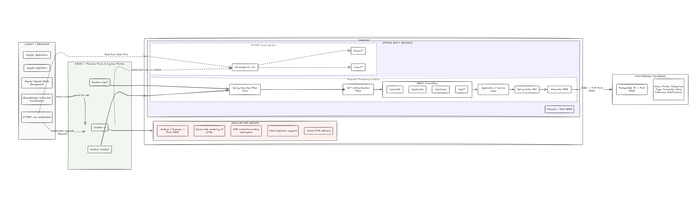
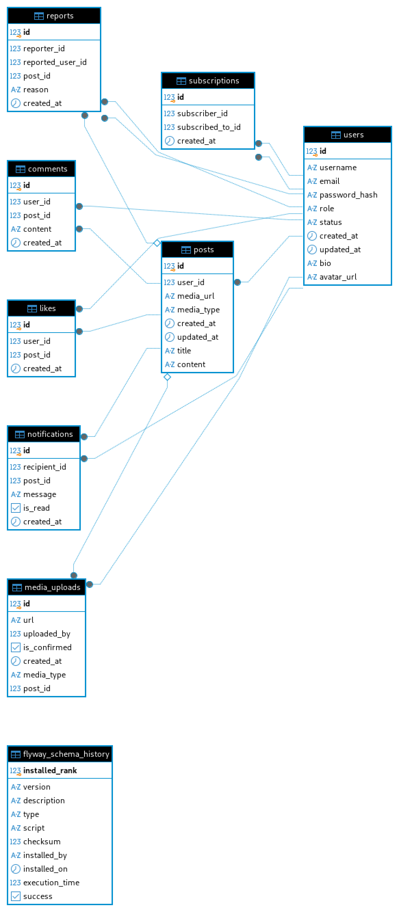
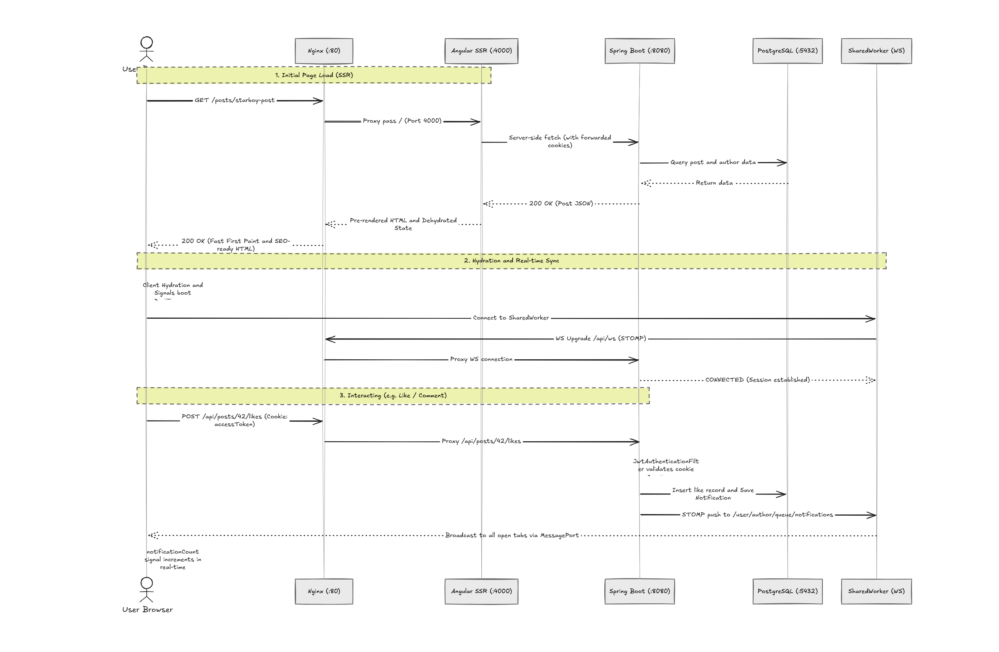

# 01-BLOG


> Engineered with **Clean Architecture**, **Angular Universal (SSR)**, **Spring Boot 3**, **Spring Security (JWT in HttpOnly Cookies)**, **PostgreSQL**, **STOMP/WebSocket Real-Time Notifications**, and a **Dockerized Nginx Gateway**.

---

## 📑 Quick Navigation & Detailed Documentation

This repository contains exhaustive, software-engineer-grade specifications for every layer of the platform:

| Document | Scope & Highlights | Link |
|---|---|---|
| 🖥️ **Frontend Architecture** | Angular 22+, Clean Architecture (Domain / Application / Infrastructure / Presentation), Signals Reactive State, SharedWorker STOMP WebSocket, SSR Cookie Forwarding, Auth Guards | [FRONTEND_ARCHITECTURE.md](./FRONTEND_ARCHITECTURE.md) |
| ⚙️ **Backend & API Reference** | Spring Boot 3 MVC, Spring Security 6 filter chains, Stateless JWT in HttpOnly Cookies, Dual-layer CORS, JPA/Hibernate schemas, Full REST API Catalog & STOMP Broker | [BACKEND_API_DOCUMENTATION.md](./BACKEND_API_DOCUMENTATION.md) |
| 📖 **Interactive API Docs (Swagger UI)** | Live interactive REST API testing interface, schema inspector & OpenAPI 3.0 specification | [http://localhost/api/swagger-ui.html](http://localhost/api/swagger-ui.html) |
| 🗄️ **Database & JPA Schema** | PostgreSQL 15 relational ERD, 8 JPA Entities (`User`, `Post`, `Comment`, `Like`, `Subscription`, `Notification`, `MediaUpload`, `Report`), constraints & fetch strategies | [Section Below](#🗄️-database-architecture--entity-relationships-jpa-schema) |
| 📦 **Infrastructure & Compose** | Multi-container Docker setup, Nginx reverse proxy routing, persistent PostgreSQL volume | [docker-compose.yml](./docker-compose.yml) |

---

## 🏛️ End-to-End System Architecture

The following system architecture diagram illustrates how client requests and real-time streams interface with the **Nginx** ingress router, fanning out across the **Angular SSR Server** (port 4000), the **Spring Boot REST/WebSocket Backend** (port 8080), and the **PostgreSQL** relational database (port 5432):



### Architectural Overview & Port Mapping
The following diagram illustrates how incoming traffic traverses from client devices through **Nginx**, fanning out to the **Angular SSR Server**, **Spring Boot REST/WebSocket API**, and persistent storage:

```
                           +---------------------------------------+
                           |          CLIENT / BROWSER             |
                           |   Angular App (Hydrated) + Signals    |
                           |   + SharedWorker (STOMP WebSocket)    |
                           +-------------------+-------------------+
                                               |
                                     Port 80 (HTTP / WS)
                                               v
                 +-----------------------------------------------------------+
                 |                       NGINX GATEWAY                       |
                 |               (Reverse Proxy & Ingress Router)            |
                 +-----------------------------+-----------------------------+
                                               |
                 +-----------------------------+-----------------------------+
                 |                             |                             |
      location /                               location /api/               location /media/
      proxy_pass :4000                         proxy_pass :8080              proxy_pass :8080
                 |                             |                             |
                 v                             v                             v
+---------------------------------+  +---------------------------------------------------+
|      ANGULAR SSR SERVER         |  |             SPRING BOOT BACKEND                   |
|   (Node.js / Express Engine)    |  |        (Tomcat @ 8080, Spring Security)           |
|                                 |  |                                                   |
| - Pre-renders HTML for SEO      |  | - SecurityFilterChain & JwtAuthFilter             |
| - SSR Cookie Forwarding Interc. |  | - REST Controllers (/api/auth, /api/posts, ...)   |
| - Client Hydration provider     |  | - SimpleBroker STOMP Broker (/ws, /topic, /user)  |
| - Fast First Contentful Paint   |  | - Spring Data JPA & Hibernate 6                   |
+---------------------------------+  +-------------------------+-------------------------+
                                                               |
                                                       JDBC / Port 5432
                                                               |
                                                               v
                                             +-----------------------------------+
                                             |       POSTGRESQL DATABASE         |
                                             |          (postgres:15)            |
                                             |                                   |
                                             | - users, posts, comments          |
                                             | - likes, subscriptions            |
                                             | - notifications, media_uploads    |
                                             | - reports                         |
                                             +-----------------------------------+
```

### 🗄️ PostgreSQL Database Schema & Entity Relationships
The following diagram illustrates the complete relational database schema and table relationships (`users`, `posts`, `comments`, `likes`, `subscriptions`, `notifications`, `media_uploads`, `reports`, and `flyway_schema_history`):



---

## 🔄 Sequence Diagram: Request & Real-time Flow

The following data flow diagram traces the lifecycle of user actions across the platform—highlighting initial Server-Side Rendering (SSR) page delivery, browser hydration, cross-tab SharedWorker STOMP WebSocket synchronization, and authenticated REST interactions:



---

## 🧩 Architectural Pillars

### 1. Frontend: Clean Architecture + Signals (Angular 22)
* **Domain Layer**: Pure entities (`User`, `Post`, `Comment`) and repository interfaces (`AuthRepository`). Zero external dependencies.
* **Application Layer**: Business use cases (`LoginUseCase`, `GetFeedUseCase`) and signal-based state stores (`AuthStateService`, `NotificationStateService`).
* **Infrastructure Layer**: Concrete implementations (`AuthRepositoryImpl`), HTTP interceptors forwarding JWT cookies during SSR and CSR, and WebSocket client services.
* **Presentation Layer**: Standalone components, reactive forms, signal computed selectors, and Tailwind/Vanilla CSS styling.
* **SharedWorker Real-Time Optimization**: A single background Web Worker manages the STOMP/SockJS connection across all browser tabs, eliminating duplicated socket connections and syncing unread counts across all active tabs instantly.

### 2. Backend: Secure Spring Boot 3 Engine
* **Stateless Authentication with HttpOnly Cookies**: Tokens (`accessToken` and `refreshToken`) are stored exclusively in HttpOnly, SameSite cookies to protect against XSS and token-theft attacks.
* **Spring Security 6 Filter Chain**: Custom `JwtAuthenticationFilter` intercepts requests, extracts cookies, resolves claims, and sets the authenticated `SecurityContextHolder`.
* **Layered Onion Architecture**: Controller (`@RestController`) $\to$ Service (`@Service`, `@Transactional`) $\to$ Repository (`JpaRepository`) $\to$ Database Entities.
* **STOMP In-Memory Message Broker**: Dispatches user-targeted events (`SimpMessagingTemplate.convertAndSendToUser`) for likes, comments, and mentions.
* **Media Storage**: Configurable static media uploads served through protected path handlers.

### 3. Gateway & Reverse Proxy (Nginx)
* Single point of ingress on port **80**.
* Routes root traffic (`/`) to the Angular Universal Node.js engine at `http://frontend:4000`.
* Routes backend endpoints (`/api/`) and media uploads (`/media/`) to `http://backend:8080`.
* Preserves original request metadata with `Host`, `X-Real-IP`, and `X-Forwarded-For` headers.

---

## 🗄️ Database Architecture & Entity Relationships (JPA Schema)

The persistent storage layer is built upon PostgreSQL 15, managed directly through **Jakarta Persistence (JPA)**, **Hibernate 6**, and versioned via **Flyway** migrations.

### Physical PostgreSQL Database Schema
The following diagram illustrates the physical tables, column data types, foreign keys, and indexes present in the PostgreSQL `blogdb` database:

---

### 2. JPA Entities & Relational Cardinality

| Entity / Table | Primary Key | Foreign Keys & Relationships | Key Constraints & Indexes |
|---|---|---|---|
| **`users`** (`User.java`) | `id` (BIGINT) | Parent to posts, comments, likes, subscriptions, notifications, media, reports | `UNIQUE(username)`, `UNIQUE(email)`, Enums: `Role` (USER, ADMIN), `UserStatus` (ACTIVE, BANNED) |
| **`posts`** (`Post.java`) | `id` (BIGINT) | `user_id` $\to$ `users.id` (Many-to-One, Lazy) | Non-null `title` & `content`, optional `media_url` and `media_type` |
| **`comments`** (`Comment.java`) | `id` (BIGINT) | `user_id` $\to$ `users.id`<br>`post_id` $\to$ `posts.id` | Many-to-One (Lazy) on both user and post. Full textual content |
| **`likes`** (`Like.java`) | `id` (BIGINT) | `user_id` $\to$ `users.id`<br>`post_id` $\to$ `posts.id` | `@UniqueConstraint(columnNames = {"user_id", "post_id"})` ensures idempotent one-like-per-user-per-post |
| **`subscriptions`** (`Subscription.java`) | `id` (BIGINT) | `subscriber_id` $\to$ `users.id`<br>`subscribed_to_id` $\to$ `users.id` | `@UniqueConstraint(columnNames = {"subscriber_id", "subscribed_to_id"})` enforces single follow edge between users |
| **`notifications`** (`Notification.java`) | `id` (BIGINT) | `recipient_id` $\to$ `users.id`<br>`post_id` $\to$ `posts.id` | Event payload with `is_read` flag. Dispatched over STOMP `/user/{id}/queue/notifications` |
| **`media_uploads`** (`MediaUpload.java`) | `id` (BIGINT) | `uploaded_by` $\to$ `users.id`<br>`post_id` $\to$ `posts.id` (Nullable) | Tracks pre-upload lifecycle (`is_confirmed`), linked to post upon publication |
| **`reports`** (`Report.java`) | `id` (BIGINT) | `reporter_id` $\to$ `users.id`<br>`reported_user_id` $\to$ `users.id`<br>`post_id` $\to$ `posts.id` (Nullable) | Moderation audit log detailing violation reports on users and specific posts |

### 3. JPA Data Access & Performance Optimizations
* **Lazy Loading by Default (`FetchType.LAZY`)**: Every `@ManyToOne` relationship uses `FetchType.LAZY` to avoid accidental `EAGER` joins and prevent $N+1$ query cascades across the persistence layer.
* **Composite Unique Constraints**: Database-level uniqueness (`likes(user_id, post_id)` and `subscriptions(subscriber_id, subscribed_to_id)`) prevents race-condition duplications.
* **Audit Lifecycle Hooks**: Entity creation and mutation timestamps are automated through `@PrePersist` and `@PreUpdate` lifecycle callbacks.

---

## 🛠️ Tech Stack & Ecosystem

```
Frontend:
  ├── Angular 22 (Standalone Components)
  ├── Angular Universal (SSR with Express engine)
  ├── Angular Signals (Fine-grained state reactivity)
  ├── RxJS (Complex stream piping)
  ├── STOMP.js & SockJS (WebSocket protocol)
  └── Web SharedWorkers (Cross-tab connection pooling)

Backend:
  ├── Java 17+ / Spring Boot 3.x
  ├── Spring Security 6 (Stateless JWT Filter)
  ├── Spring Data JPA / Hibernate 6
  ├── Spring WebSocket & STOMP Messaging
  ├── PostgreSQL 15 (Relational persistence)
  └── Maven Build System

DevOps & Infrastructure:
  ├── Docker & Docker Compose
  ├── Nginx Alpine (Reverse Proxy & Ingress)
  └── Multi-stage container builds
```

---

## 🚀 Running the Platform Locally

### Prerequisites
- [Docker](https://docs.docker.com/get-docker/) & [Docker Compose](https://docs.docker.com/compose/)
- Node.js 20+ (for standalone frontend development)
- JDK 17+ & Maven (for standalone backend development)

### 1. Unified Startup (Docker Compose)

From the project root:

```bash
# Clone the repository
git clone https://github.com/saidxp/01-BLOG.git
cd 01-BLOG

# Start all micro-services (Nginx, Angular SSR, Spring Boot, PostgreSQL)
docker compose up --build -d
```

### 2. Verified Service Ports

| Service | Container Name | Internal Port | Exposed Port |
|---|---|---|---|
| **Nginx (Ingress Gateway)** | `blog-nginx` | `80` | `http://localhost:80` |
| **Angular SSR Frontend** | `blog-frontend` | `4000` | Routed through Nginx `/` |
| **Spring Boot Backend** | `blog-backend` | `8080` | Routed through Nginx `/api/` |
| **PostgreSQL Database** | `blog-postgres` | `5432` | Internal bridge network |

### 3. Local REST API Testing (Swagger UI & OpenAPI)

Once the backend container is running, the interactive Swagger UI and OpenAPI documentation are accessible locally for executing and testing all REST endpoints:

| Interface | URL | Description |
|---|---|---|
| 🌐 **Swagger UI (via Nginx Gateway)** | [http://localhost/api/swagger-ui.html](http://localhost/api/swagger-ui.html) | Interactive web UI to execute & test all REST endpoints |
| ⚙️ **Swagger UI (Direct Backend)** | [http://localhost:8080/api/swagger-ui.html](http://localhost:8080/api/swagger-ui.html) | Direct connection to Tomcat port 8080 |
| 📄 **OpenAPI Specification (JSON)** | [http://localhost/api/v3/api-docs](http://localhost/api/v3/api-docs) | Raw OpenAPI 3 JSON definition |

---

## 👥 Authors & Presentation Credit
Developed and architected by Said Oubaaisse .  
For technical inquiries or architecture walkthroughs, consult the [Backend Documentation](./BACKEND_API_DOCUMENTATION.md) and [Frontend Architecture](./FRONTEND_ARCHITECTURE.md).
